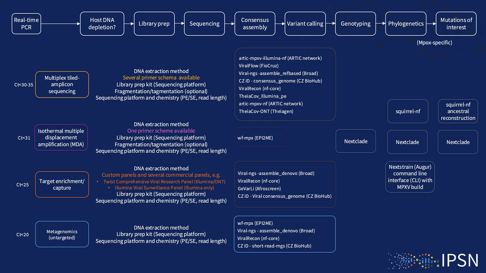

 

In an effort to help countries navigate the many options available in terms of both wet-lab and dry-lab approaches to MPXV genomics the Better Tools and Standards workstream have begun to collate a landscape analysis of the current methods.

We welcome updates either through pull-requests or via issues to this repository.
### Community curated landscape of MPXV genomics

#### Clade, outbreak and lineage nomenclature

MPXV naming changed twice after this page was first written, and both changes affect how results should be reported.

**December 2025 — outbreak names.** Outbreak nomenclature now follows the system described in [Ruis et al. (2025)](https://www.nature.com/articles/s41591-025-03820-6).  The clade IIb outbreak previously called `hMPXV-1` is now `sh2017`.  The clade Ib outbreak is `sh2023`.  The clade Ia outbreak described in [Wawina-Bokalanga et al. (2025)](<https://www.thelancet.com/journals/lancet/article/PIIS0140-6736(25)00294-6/fulltext>) is `sh2024`.  This took effect in the Nextclade mpox datasets on 10 December 2025 and in the Nextstrain phylogenetic workflow's default filters on the same date.

**July 2026 — lineages within clade Ib.** Clade Ib/`sh2023` now has defined lineages, following the same scheme as clade IIb/`sh2017`, with root lineage `A`.  Because lineage letters are no longer unique across outbreaks — `A` exists in both `sh2017` and `sh2023` — a lineage must be reported together with its outbreak.  Nextclade provides an `outbreakLineage` field for this, giving values such as `sh2023/A.1`.

Clade names (`I`, `Ia`, `Ib`, `II`, `IIa`, `IIb`) are unchanged and remain correct for describing the virus.  When referring to the current outbreak rather than the clade, prefer the outbreak label, and report `outbreakLineage` rather than a bare lineage letter.

#### Primer Schemes

For multiplex tiled-amplicon sequencing several primer schemes are available.  These primer schemes are agnostic of the downstream sequencing platform although platform specific pre-processing (e.g. fragmentation) maybe required.

Primer schemes are designed against single or multiple references.  Most were originally designed against a clade IIb reference.  Since 2024 the question of whether a scheme works for clade Ib has largely been answered by scheme authors publishing clade-specific builds, and the [ARTIC primer scheme registry](https://github.com/quick-lab/primerschemes) is the authoritative source for these.  Each carries a validation status (`validated`, `tested`, `draft`).  Prefer a clade-matched build where one exists.

**Schemes in the ARTIC registry** (checked 1 November 2026):

| Scheme                 | Amplicon (bp) | Primers | Clade-specific builds                                                                  | Status      | Reference used        |
| ---------------------- | ------------- | ------- | -------------------------------------------------------------------------------------- | ----------- | --------------------- |
| `artic-inrb-mpox/2500` | 2500          | 148     | `cladeia`, `cladeib`, `cladeiia`, `cladeiib`; latest general build `v1.0.1`             | validated   | `KJ642613.1` (masked) |
| `artic-inrb-mpox/400`  | 400           | 1180    | —                                                                                      | **draft**   | `KJ642613.1` (masked) |
| `bccdc-mpox/2500`      | 2500          | 158     | —                                                                                      | validated   | `NC_063383.1`         |
| `bccdc-mpox/3000`      | 3000          | 154     | —                                                                                      | tested      | —                     |
| `yale-mpox/2000`       | 2000          | 328     | `cladei`                                                                               | tested      | `KJ642613.1`          |
| `yale-mpox/2000`       | 2000          | 326     | `cladeii`                                                                              | validated   | —                     |

The 400 bp ARTIC/INRB scheme is referenced in WHO's *Analytical considerations for genomic surveillance of mpox virus* (December 2025) and is marked `draft` upstream; that status should be taken into account before deploying it.

**Published schemes not in the registry.** These are kept for reference.  Their clade Ib performance has not been re-assessed for this page and the figures below are as originally published.

| Primer Scheme​                     | Amplicon size (bp)​ | No. primers​ | Clade reference​      | Protocol or repo​                                                                                        | Citation​                                       |
| ---------------------------------- | ------------------- | ------------ | --------------------- | -------------------------------------------------------------------------------------------------------- | ----------------------------------------------- |
| Brinkmann 2024​                    | 375​                | 682​         | IIb (ON585033.1)​     | ​                                                                                                        | https://doi.org/10.1016/j.jviromet.2024.114888​ |
| INRB​                              | 2000​               | 326​         | IIb (MT903345)​       | https://github.com/inrb-labgenpath/DRC_MPXV_primers​                                                     | ​                                               |
| Welkers (Erasmus /Rigshospitalet)​ | 2500​               | 176​         | IIb (ON563414.3)​     | https://www.protocols.io/view/monkeypox-virus-whole-genome-sequencing-using-comb-n2bvj6155lk5/v1?step=1​ | https://www.eurosurveillance.org/content/10.2807/1560-7917.ES.2024.29.11.2400106 |
| Bosmeny 2023​                      | 3000​               | 141​         | IIb (NC_063383.1)​    | https://github.com/gagnonlab/artic-mpxv​                                                                 | http://dx.doi.org/10.1186/s12985-023-02059-2​   |
| Isabel 2023​                       | 5000​               | 98​          | IIb (ON563414.3)​     |                                                                                                          | https://doi.org/10.1128/spectrum.02979-23       |
| Licheri 2024​                      | varies​             | 6+1​         | IIb (ON792320.1)​     | ​                                                                                                        | https://doi.org/10.21203/rs.3.rs-4024102/v1     |

Scheme information adapted from https://artic.network/viruses/mpxv

#### Bioinformatic workflows for consensus generation from amplicon sequencing

The generation of an MPXV consensus sequence from a tiled-amplicon sequencing run requires multiple bioinformatic steps including filtering and trimming of host and primer sequences, mapping reads to the appropriate reference genome and identifying variants in the new sequence.  There are many options for end-to-end workflows that perform these individual steps supporting different sequencing platforms.  These pipelines generally utilize a workflow management system (i.e. Nextflow / WDL) that facilitate the integration of these diverse tools and containerization to enable deployment across different platforms and environments.  Despite the wide choice of workflows listed below we can see that many of the tools, while sequencing platform specific, are shared across different implementations.  

| **Pipeline**                                                                      | **Sequencing Platform**      | **Workflow Language** | **Containerized**    | **Host Removal**        | **Trimming**        | **Primer Removal** | **Reference Mapping** | **Variant Calling**        | **MSA** | **Annotation** | **Last checked upstream** |
| --------------------------------------------------------------------------------- | ---------------------------- | --------------------- | -------------------- | ----------------------- | ------------------- | ------------------ | --------------------- | -------------------------- | ------- | -------------- | -------------------- |
| [artic-mpxv-nf](https://github.com/artic-network/artic-mpxv-nf)                   | ONT                          | Nextflow              | Docker (Epi2Me)      | artic                   | artic guppyplex     | artic minion       | artic minion          | artic minion               | -       | -              | quiet since 2025-06 |
| [TheiaCoV (PHB)](https://github.com/theiagen/public_health_bioinformatics)              | ONT                          | WDL                   | Docker / Singularity | NCBI SRA Human Scrubber | artic guppyplex     | artic minion       | artic minion          | artic minion               | -       | -              | active (2026-10) |
| [ViralRecon - ONT](https://github.com/nf-core/viralrecon)                         | ONT                          | Nextflow              | Docker / Singularity | -                       | artic guppyplex     | artic minion       | artic minion          | artic minion               |         | SnpEff         | active (2026-10) |
| [Cecret](https://github.com/UPHL-BioNGS/Cecret)                                   | Illumina / ONT               | Nextflow              | Docker / Singularity | -                       | fastp / segyclean   | ivar               | bwa / minmap2         | ivar / samtools / bcftools | Mafft   | Vadr           | active (2026-10) |
| [Viral ngs (assemble_refbased)](https://github.com/broadinstitute/viral-ngs)      | Illumina / ONT / PacBio      | WDL                   | Docker               | -                       |                     | ivar               | minimap2              |                            | -       | -              | active (2026-10) |
| [artic-mpxv-illumina-nf](https://github.com/artic-network/artic-mpxv-illumina-nf) | Illumina                     | Nextflow              | Docker (Epi2Me)      | Hostile                 | trim-galore         | ivar               | bwa                   | Freebayes                  | Mafft   |                | quiet since 2025-04 |
| [TheiaCoV_Illumina_PE_PHB](https://github.com/theiagen/public_health_bioinformatics)  | Illumina                     | WDL                   | Docker / Singularity | Kraken2                 | trimmomatic / bbduk | ivar               | bwa                   | ivar / samtools / bcftools | -       | -              | active (2026-10) |
| [ViralFlow](https://github.com/WallauBioinfo/ViralFlow)            | Illumina                     | Nextflow              | Singularity                   | -                       | fastp / samtools    | fastp              | bwa                   | ivar / samtools / bcftools | mafft   | SnpEff         | active (2026-10) |
| [CZ ID viral consensus genome](https://czid.org/)                                 | Illumina                     | WDL                   | No - SaaS            | minimap2                | trim-galore         | ivar               | minimap2              | ivar / samtools / bcftools | -       | -              | hosted service |
| [GeVarLi](https://forge.ird.fr/transvihmi/nfernandez/gevarli)                     | Illumina                     | Snakemake             | No                   | -                       | cutadapt/sickle     | bamclipper         | bwa/minimap2/bowtie2  | ivar / samtools / bcftools | -       | -              | not assessed |
| [ViralRecon - illumina](https://github.com/nf-core/viralrecon)                    | Illumina                     | Nextflow              | Docker / Singularity | Kraken2                 | fastp               | ivar               | bowtie2               | ivar / samtools / bcftools | -       | SnpEff         | active (2026-10) |
| [Viridian](https://github.com/iqbal-lab-org/viridian)                             | Illumina / ONT / Ion Torrent | N/A                   | Docker / Singularity | -                       |                     |                    | minimap2              | cyclon                     | maft    | -              | quiet since 2025-03 |
| [Polkapox](https://github.com/CDCgov/polkapox)                                    | Illumina                     | Nextflow              | Docker / Singularity | Kraken2                 | fastp               | ivar               | bwa                   | ivar / samtools / bcftools | -       | -              | active (2026-10) |
| [INSaFLU-TELEVIR](https://insaflu.insa.pt/)                                    | Illumina / ONT / Ion Torrent                    | N/A             | Docker  | bwa / bowtie2 / minimap                 | trimmomatic / nanofilt               | ivar               | bwa  / medaka                 | freebayes / samtools / bcftools / medaka | mafft / nextalign     | SnpEff / Nextstrain             | hosted service |

Upstream status was checked on 1 November 2026 and is given so that a reader can weigh how actively a workflow is maintained; it is not a judgement of quality.  Two entries were repointed in November 2026: the TheiaCoV workflows moved to Theiagen's Public Health Bioinformatics repository, and ViralFlow moved to `WallauBioinfo/ViralFlow`.  The per-step tool columns below have not been re-verified against current releases of each workflow and should be treated as indicative.

#### Consensus Sequencing Post-Processing

The MPXV genome has certain features that need to be considered when generating a consensus sequence to ensure that erroneous variation is not incorporated.  These include both large inverted repeats and short tandem repeats whose copy number is difficult to ascertain, deletions and rearrangements in the genome, and an overall low GC content.  To mitigate the uncertainty of variant calling in these regions, strategies that mask regions of the genome have been incorporated into software such as [NextStrain](https://github.com/nextstrain/mpox/tree/master) or [squirrel](https://github.com/aineniamh/squirrel) to aid accurate phylogenetic construction.  Two different problems are easily conflated here, and they need different treatment.  **Artefacts confined to individual sequences** — a mutation adjacent to a tract of Ns, a call to the reference base, several mutations clustered on one branch — are properties of that sequence, not of the genome, and should be masked only in it; squirrel supports this through `--sequence-mask`.  **Problematic regions of the genome** — inverted terminal repeats, tandem and low-complexity repeats, regions where assembly is unreliable for everyone — are properties of MPXV and should be masked across the whole alignment, which is what squirrel's built-in masks and `--additional-mask` do.  Applying the first kind as the second removes phylogenetically informative sites from good sequences in order to suppress artefacts present in poor ones, because a site noticed this way is by definition a variable site.

Masking coordinates are only meaningful alongside the reference they are expressed in, and clade I now has four frames in active use: `NC_003310`; `PX667572` (squirrel >= 1.3.2); `KJ642613.1` (the Nextstrain phylogenetic clade I build, and the reference selection for the ARTIC/INRB schemes); and `DQ011155.1` (the Nextclade clade I dataset).  Masks are not interchangeable between frames without translation.

Curated masking for clade I is maintained in the tools themselves — squirrel's built-in mask files, and `phylogenetic/defaults/clade-i/mask.bed` in [nextstrain/mpox](https://github.com/nextstrain/mpox) — and both apply structural masking by default, so most users need no additional file.  squirrel's `-qc` mode will flag candidate sites in your own data, which is the right way to derive per-sequence masking rather than inheriting someone else's.

[squirrel](https://github.com/aineniamh/squirrel) has grown well beyond alignment and masking and now also covers clade assignment, consensus QC with problematic-SNP flagging, phylogenetics, APOBEC3 mutation reconstruction, pan-clade alignment against a composite reference, and variola.  It is not listed in the consensus-generation table above because it does not generate consensus sequences from amplicon reads.

The IPSN [phylomasking repository](https://github.com/WHO-Collaboratory/collaboratory-mpox-genomics-phylomasking) was **deprecated in November 2026**: its coordinates predate squirrel's change of clade I reference, and it did not separate the two tiers described above.  This work is moving to the WHO Collaboratory Pathogen Genomics Commons, which will hold the two tiers separately, with the evidence, reference frame and review date recorded for each entry.

Note finally that masking is no longer cost-free.  The Nextclade clade I dataset removed the range 185990-186092 from its placement mask in July 2026 because it is informative for lineage assignment within clade Ib.  Masking more is not automatically safer.

#### Data sources for public MPXV analyses

Both main public MPXV products now draw their sequence data from [Pathoplexus](https://pathoplexus.org/) rather than directly from INSDC:

* The **Nextclade mpox datasets** moved to Pathoplexus on 25 April 2025.  The dataset changelog notes that this allows inclusion of restricted-use clade I sequences and "nearly doubles clade I sequences available" — the restricted-use mechanism is therefore materially increasing the clade I data available for analysis.
* The **Nextstrain mpox workflow** moved its ingest to the Pathoplexus API on 10 November 2025, archiving the pre-transition data files.

**Nextclade datasets for MPXV** now cover `all-clades`, `clade-i`, `clade-iib` and `lineage-b.1`.  The clade I dataset (reference `DQ011155.1`) provides clade, outbreak and lineage assignment plus sequence QC without requiring a command line, which may suit settings where a full pipeline is not practical.

---

*Page last reviewed: 1 November 2026.  Tool and scheme links were checked against their upstream sources on that date.  Please raise an issue or a pull request if you find something out of date.*
